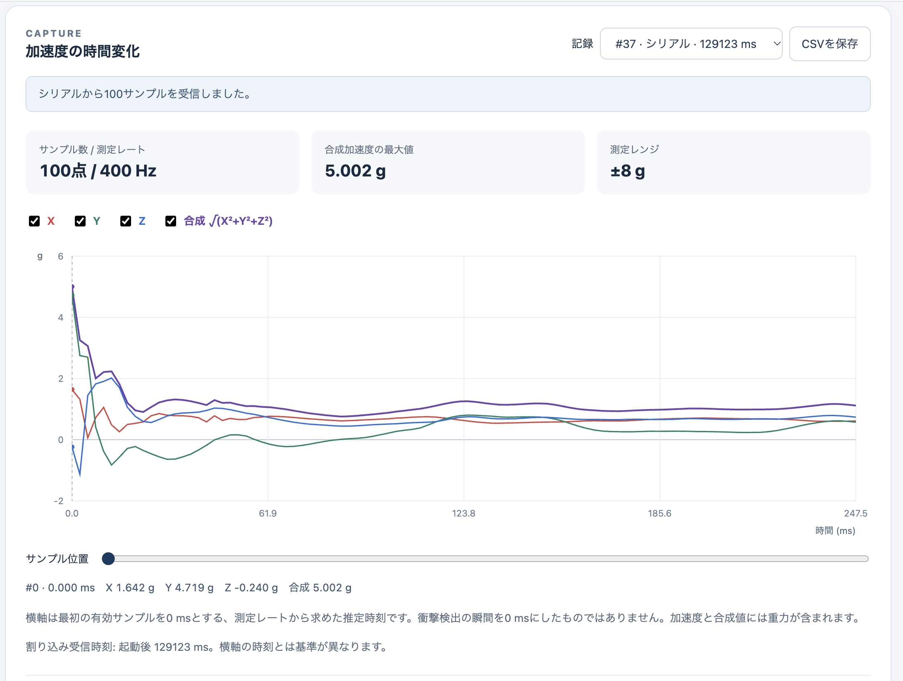

# 衝撃検出後の100サンプルをFIFOで記録する（accel_shock_fifo）

AP03 STM32とAI05 Env Sensorsを接続し、LIS2DW12のWake-up割り込みを衝撃検出として使います。**検出後の加速度を100サンプル取得し、PCのブラウザーでX/Y/Zと合成加速度の波形を表示**します。既存の`accel_wakeup`とは独立したPlatformIOプロジェクトです。

## 記録するデータ

| 項目 | 初期設定 |
| --- | --- |
| CPU | AP03 STM32（`leafony_ap03`） |
| センサ | LIS2DW12、I2C `0x18`（`0x19`も検出） |
| I2C | SDA=PB9（D14）、SCL=PB8（D15）、400 kHz |
| 割り込み | INT1 → Leafony Bus D3 → AP03 PB3、立ち上がり |
| 測定 | 400 Hz、高性能・低ノイズ、±8 g |
| 衝撃検出 | ハイパス経路のしきい値0.500 g、追加継続時間なし |
| FIFO | Bypass-to-continuous、容量32サンプル |
| 保存 | 検出後100サンプル、RAM使用600バイト（生の3軸値） |
| 時間軸 | 2.5 ms間隔、0〜247.5 ms（約0.25秒分） |
| シリアル | 115200 bps、8N1 |

Leafony Busで接続すれば割り込み線の追加配線は不要です。3.3 VとAP03側のI2Cプルアップを使用します。D3を共有するAI01や、I2C `0x18` が重複するAX06は同時接続しないでください。

ここでいう衝撃は、Wake-up機能による短い加速度変化の検出です。静的な傾きや一定の加速度には反応しにくい設定です。**衝撃前の履歴は保存しません。** トリガの次の測定からFIFO収集が始まり、仕様に従って先頭1サンプルを破棄してから100サンプルを保存するため、衝撃発生瞬間のピークを捉える保証はありません。

表示する加速度は重力を含むローパス出力です。検出に使うハイパス値とは異なり、表示値としきい値を直接比較できません。合成加速度は`√(X²+Y²+Z²)`なので、静止時もおおむね1 gです。MCUのSleep／Stopは使用しません。

## 1. ビルド・書き込み

VS Codeではこの`platformio/accel_shock_fifo/`フォルダーを開きます。Arduinoの`Wire`を使い、追加のセンサライブラリは不要です。

以下はリポジトリのルートから実行します。

```sh
pio run -d platformio/accel_shock_fifo
pio device list
```

シリアルモニターや波形ビューアの接続を閉じ、AP03を**Program側にしてReset**を押してから書き込みます。

```sh
pio run -d platformio/accel_shock_fifo -t upload --upload-port /dev/cu.usbserial-XXXX
```

ポートは実機に合わせて変更してください。Windowsでは`COM3`などを指定します。書き込み後は**Run側へ戻します**。

## 2. 波形ビューアを開く

Python 3でローカルサーバーを起動します。Pythonパッケージやnpmパッケージの追加は不要です。

```sh
python3 -m http.server 8765 --bind 127.0.0.1 --directory platformio/accel_shock_fifo/viewer
```

PC版ChromeまたはEdgeで **<http://127.0.0.1:8765/>** を開きます。Windowsで`python3`が見つからない場合は`python`を使用してください。

1. 「シリアル接続」を押して、AP03を接続したUSBシリアルポートを選びます。
2. AP03がRun側であることを確認してResetを押し、初期化中は基板を静止させます。
3. 「衝撃を待っています」と表示されたら、基板を軽く動かすなどして短い加速度変化を与えます。
4. 記録完了後、100点の波形が表示されます。約0.25秒の取得とシリアル送信、500 msの待機を経て次の衝撃を受け付けます。

収集中・送信中・待機中の追加の衝撃は別記録にしません。連続する衝撃をすべて保存するロガーではありません。強くたたく必要はなく、反応しにくい場合は先にしきい値を下げてください。

ビューアには次の機能があります。

- X/Y/Zと合成加速度の表示切り替え、カーソルによる各サンプル値の確認
- 最新20記録の切り替え、100点の数値表、合成加速度の最大値
- CSV保存と再読み込み、測定レンジ上限付近の値の通知
- 「デモを見る」による、接続なしの表示確認（生成データであり実機測定ではありません）



実機から取得した波形の表示例（100サンプル、400 Hz、±8 g）。この記録の合成加速度の最大値は5.002 gです。

横軸の`time_ms`は**最初の採用サンプルを0 ms**として、設定した測定レートから計算した推定値です。センサFIFOには時刻が含まれず、各サンプルの実時刻を測ったものではありません。`trigger_ms`はMCUが割り込みを受けた時の起動後ミリ秒で、横軸とは基準が異なります。

記録はブラウザーのメモリー内だけに保持します。ページを閉じる前に必要な記録をCSVで保存してください。データを外部へ送信する処理や外部CDNはありません。シリアル接続に対応しないブラウザーでも、CSVとデモは利用できます。

## 3. シリアル出力だけで確認する

ブラウザーのシリアル接続と同時にポートを開くことはできません。ビューアを切断してから実行してください。

```sh
pio device monitor -d platformio/accel_shock_fifo --port /dev/cu.usbserial-XXXX --baud 115200
```

成功した記録は、開始行・列名・100行の測定値・終端行で構成されます。以下は書式の説明用に途中を省略した例です。

```text
# capture_begin,id=1,trigger_ms=3210,odr_hz=400,range_g=8,count=100,source=hardware
index,time_ms,x_g,y_g,z_g
0,0.000,0.0127,-0.0342,0.9975
...
99,247.500,0.0000,0.0000,0.9994
# capture_end,id=1
```

CSVとして保存するときは、**開始行・終端行も含めます**。ビューアは100点、番号の連続性、時刻と測定レート、開始と終端のIDを検証し、欠けた記録を表示しません。デモのCSVは`source=demo`を保存し、再読み込み後もデモと表示します。

エラー時には`# capture_error,id=...,reason=...,collected=...`を出力し、その記録の波形は送信しません。初期化・再アーム・停止処理が失敗した場合は`# fatal,reason=...`を出力して停止するので、接続を確認してResetを押します。

## FIFOの使い方と変更箇所

`src/Lis2dw12ShockFifo.h`がセンサ設定、`src/ShockCapture.h`が100点の収集と検証、`src/main.cpp`が割り込み受付と送信を担当します。

1. 待機時はBypass-to-continuousモード。衝撃を検出すると、センサ内部でFIFOへの収集を開始します。
2. ISRは時刻と通知フラグだけを記録します。`WAKE_UP_SRC`はまだ読みません。
3. `loop()`でFIFO未読数を確認し、6バイトずつRAMへ移します。FIFOの先頭1点を捨てた後、100点がそろうまで繰り返します。
4. FIFOを停止してから`WAKE_UP_SRC`を読み、最後にINT1の出力割り当てを解除します。収集中に原因を読むとラッチが解除され、FIFO収集も停止するためです。
5. 完成した記録を送信し、500 ms待ってからFIFOと割り込みを再設定します。

FIFOの32点は400 Hzで80 ms分です。あふれ、I2C読み取り失敗、1秒の取得タイムアウト、読み出し遅延を検出した記録は無効にします。読み出しであふれフラグが消える場合にも備え、残り容量と保守的な2 ms周期から読み出し期限を求めています。32点いっぱいになった状態や期限超過も、安全側に倒して`fifo_service_delayed`とします。

感度は`src/main.cpp`の`kShockThresholdCounts`で調整します。±8 gでは1カウントが0.125 gです。

| 設定 | しきい値 |
| --- | --- |
| `2` | 0.250 g（反応しやすい） |
| `4` | 0.500 g（初期値） |
| `8` | 1.000 g |

このサンプルの測定レートとレンジは固定構成です。変更する場合は、センサのレジスタ値だけでなく、換算係数・FIFO読み出し期限・送信メタデータを一緒に変更してください。

## ホスト側の検証

CSV解析のテストはNode.js 18以降で実行できます。

```sh
node --test platformio/accel_shock_fifo/viewer/capture.test.mjs
```

収集処理とI2Cドライバーは、センサを模擬してホスト上で検証できます。macOSのClangでは次のコマンドで実行します。

```sh
clang++ -std=c++17 -Wall -Wextra -Werror \
  -fsanitize=address,undefined \
  -Iplatformio/accel_shock_fifo/tests \
  -Iplatformio/accel_shock_fifo/src \
  platformio/accel_shock_fifo/tests/host_test.cpp \
  -o /tmp/ai05-shock-fifo-host-test
/tmp/ai05-shock-fifo-host-test
```

正常な100点取得に加え、先頭点の破棄、読み取り失敗、FIFOあふれ、読み出し遅延、タイムアウト、時計の周回、再アーム時のレジスタ操作を確認します。ホストテストやデモ表示は実機での測定確認を代替しません。

## 参考資料

- [LIS2DW12データシート：FIFO、初回サンプル、出力換算](https://www.st.com/resource/en/datasheet/lis2dw12.pdf)
- [ST AN5038：Wake-up、FIFOモード、データ取得](https://www.st.com/resource/en/application_note/an5038-lis2dw12-alwayson-3axis-accelerometer-stmicroelectronics.pdf)
- [通常の動き検出割り込みサンプル](../accel_wakeup/README.md)
